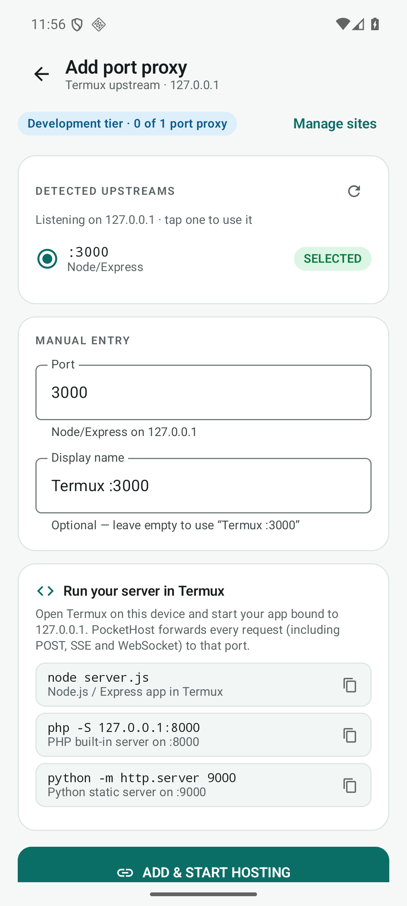
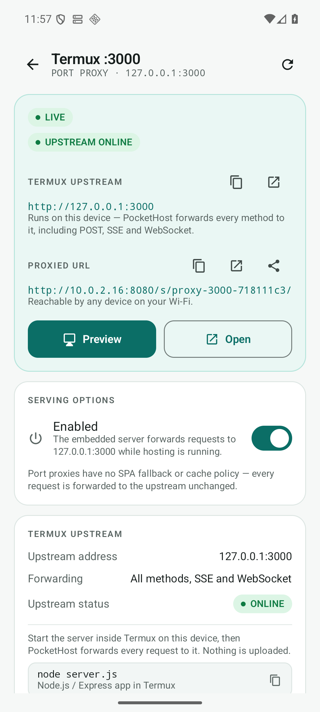
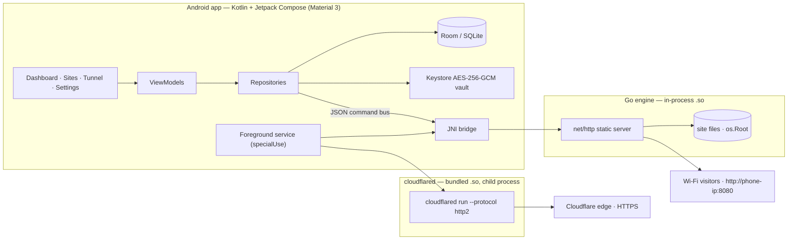

<div align="center">


# PocketHost

**A real web server in your pocket — static sites + Termux port proxies.**

Turn an ordinary Android phone into a personal website host — no Linux, no root, no command
line. Drop in a ZIP from any AI website builder, press **START HOSTING**, and the site is live on
Wi-Fi. Or reverse-proxy a Node/PHP/Python server already running in Termux (`127.0.0.1:<port>`)
under the same address — all methods, SSE and WebSocket included. Optionally expose it over HTTPS
with Cloudflare Tunnel.

<p>
  
  
  
  
</p>
<p>
  
  
  
  
  
</p>

<p>
  <a href="https://x.com/PrivyXe"></a>
  <a href="https://github.com/PrivyXe"></a>
  <a href="https://www.instagram.com/mr_cimen_"></a>
</p>


**🌐 Public hostname (served from the phone when hosting + tunnel are connected): [downmonitor.app](https://downmonitor.app/)** · **Mirror: [privyxe.github.io/PocketHost](https://privyxe.github.io/PocketHost/)** · **⬇️ Download: [latest release](../../releases/latest)**

</div>

---

## Download

Get the signed APK from **[Releases](../../releases/latest)**:

| File | Details |
|---|---|
| `PocketHost-1.1.3-arm64.apk` | 13.77 MB · `arm64-v8a` only · Android 8.0+ · signed v2+v3 |
| `PocketHost-1.1.3-arm64.apk.sha256` | SHA-256 checksum — verify before installing |
| `PocketHost-1.1.3.json` | machine-readable build manifest (versionCode 10) |

> **Sideload only.** PocketHost is not on Google Play. No account, no ads, no analytics.
> Install: open the APK on an **ARM64** Android 8.0+ phone → allow "install unknown apps" → install.

## Table of contents

- [Why PocketHost?](#why-pockethost)
- [How it compares](#how-it-compares)
- [Status](#status)
- [Screens](#screens)
- [Features](#features)
- [How it works](#how-it-works)
- [Architecture](#architecture)
- [Security model](#security-model)
- [Requirements](#requirements)
- [Install & first site](#install--first-site)
- [Using the app](#using-the-app)
- [Quality & verification](#quality--verification)
- [Repository contents](#repository-contents)
- [Known limitations](#known-limitations)
- [FAQ](#faq)
- [Troubleshooting](#troubleshooting)
- [Roadmap](#roadmap)
- [🇹🇷 Türkçe özet](#-türkçe-özet)
- [License](#license)

---

## Why PocketHost?

AI website builders made it trivial to *create* a site. Actually getting it online from a phone is
still painful: Termux, a VPS, a CI pipeline, or a monthly host. PocketHost exists to make that last
step one tap:

- **Real hosting, not a mock** — a Go `net/http` server running inside the app process.
- **No root, no Termux, no Linux** — a normal, unrooted Android phone is all you need.
- **Private by default** — nothing leaves your LAN unless you explicitly connect a tunnel.
- **Honest telemetry** — real metrics from the platform; anything unavailable is shown as
  *unavailable*, never invented.
- **One free, ad-free APK** — no account, no analytics, no paywall for local hosting.

## How it compares

| | PocketHost | Termux + nginx | VPS / cloud | Static host (Netlify, etc.) |
|---|---|---|---|---|
| Hardware needed | your phone | your phone | rented server | none |
| Root / Linux / terminal | ❌ | ✅ (terminal) | ✅ | ❌ |
| Works on local Wi-Fi only | ✅ | ✅ | ❌ (needs routing) | ❌ |
| HTTPS for the world | optional Cloudflare Tunnel | manual setup | manual DNS/TLS | ✅ |
| Cost | free | free | monthly | free tier / monthly |
| Setup time | one tap + ZIP | long | long | account + deploy config |
| Data stays on device | ✅ | ✅ | ❌ | ❌ |
| Real device metrics | ✅ | ❌ | ❌ | ❌ |

PocketHost is deliberately **not** a production server and does not embed a dynamic runtime.
It hosts static sites and can reverse-proxy a Node/PHP/Python/Go process you already run in Termux
(no Node/PHP binary in the APK, no MySQL, no Docker). It is a pocket-sized host for demos,
prototypes, portfolios and local testing.

## Status

| | |
|---|---|
| **Release** | `1.1.3` (versionCode 10) — signed ARM64 APK, 13.77 MB, `arm64-v8a` only |
| **Signed with** | project JKS, APK Signature Scheme **v2 + v3**, R8-minified |
| **Verified on** | Android 16 / API 36 emulator (x86_64): import → host → real HTTP round-trips, proxy E2E (all methods, SSE, WebSocket 101, 502, scan), Room 1→3 migration; **verified live** on a physical Android 16 phone via Named Tunnel → [downmonitor.app](https://downmonitor.app/) |
| **Engine** | Go stdlib `net/http` + `httputil.ReverseProxy`, embedded via `gomobile bind` (`libgojni.so`), 16 KB page-aligned; reverse proxy is loopback-only |
| **Tests** | 207 JVM unit tests (23 suites) + 103 top-level Go tests / 254 total + instrumented end-to-end runs (20 executed) |
| **Tunnel** | bundled `cloudflared` 2026.10.7 (pinned source, patched DNS resolver); Quick Tunnel verified externally; **Named Tunnel + custom domain verified live** (4 parallel edge connections) → [downmonitor.app](https://downmonitor.app/) |
| **License** | [MIT](LICENSE) |

> The phone is the origin: when hosting and the Named Tunnel are disconnected (or Android kills
> the app process), Cloudflare answers `1033` for this hostname. Start hosting and connect the
> tunnel to bring it back.
## Screens

<table>
  <tr>
    <td align="center"><br /><sub><b>Dashboard</b><br />server status, LAN URL, site summary</sub></td>
    <td align="center"><br /><sub><b>Metrics</b><br />requests, latency, response codes</sub></td>
    <td align="center"><br /><sub><b>Sites</b><br />static sites + Termux port proxies</sub></td>
  </tr>
  <tr>
    <td align="center"><br /><sub><b>Add port proxy</b><br />detects live upstreams :3000/:5173/…</sub></td>
    <td align="center"><br /><sub><b>Proxy detail</b><br />upstream, proxied URL, per-proxy Host mode</sub></td>
    <td align="center"><br /><sub><b>Tunnel</b><br />Quick &amp; Named Cloudflare Tunnel</sub></td>
  </tr>
  <tr>
    <td align="center"><br /><sub><b>Settings</b><br />port, bind mode, default proxy Host</sub></td>
    <td align="center"><br /><sub><b>Signed release</b><br />minified build running</sub></td>
    <td></td>
  </tr>
</table>

## Features

### Hosting
- Embedded Go HTTP server — starts in milliseconds, no child process, no shell.
- Multiple sites: default site at `/`, secondary sites at `/s/<id>/`.
- SPA fallback, ETag / Last-Modified / `304`, gzip, per-site cache policy.
- Directory index handling, custom 404/405 responses, byte-range requests.
- Foreground service (`specialUse`) + partial wake lock + Wi-Fi lock: keeps serving with the
  screen off, stops cleanly on every path (nav-bar stop, notification action, app kill, reboot).
- **Port proxies:** forward every method (GET/POST/PUT/PATCH/DELETE/OPTIONS), request bodies,
  query strings, SSE/long-poll and **WebSocket** upgrades to a loopback upstream.

### Port proxy (Termux)
- Start a server in Termux (e.g. `node server.js` on `:3000`, `php -S 127.0.0.1:8000`,
  `python -m http.server 9000`), then **Sites → ADD PORT PROXY**.
- The app scans common dev ports, lists what is actually listening and offers one-tap selection.
- The upstream is **always `127.0.0.1:<port>`** — no arbitrary host, no SSRF gadget. A proxy that
  points at PocketHost's own listening port is rejected (`PROXY_LOOP`) before it can recurse.
- Mounted under `/s/<id>/`: the prefix is stripped, `X-Forwarded-Prefix`/`X-Forwarded-Host` are set,
  absolute-path `Location` redirects are rewritten to the prefix, and absolute asset/API calls are
  routed back to the proxy via the page Referer.
- **Per-proxy Host header:** each proxy chooses `Preserve client` (original Host + `X-Forwarded-Host`)
  or `Upstream loopback` (`127.0.0.1:<port>` for Vite `allowedHosts`, Django `ALLOWED_HOSTS`, ...).
- If the upstream is offline, visitors get a branded **502** page naming the port and the Termux
  command to start it — never a fake success page. The app shows a live upstream-ONLINE check.
- Development tier: **1 static website + 1 port proxy** (independent quotas). No Node/PHP runtime is
  embedded; nothing is executed inside the app.

### Import
- ZIP, a single HTML file, or a folder (SAF document tree via OpenDocumentTree).
- Validates before touching storage: ZIP-Slip, symlinks, zip bombs, encrypted entries, duplicate
  names, corrupted entries and **per-entry CRC32**.
- Auto-detects the real website root (root `index.html`, single top-level folder, nested `public/`).
- Extracts atomically into app-private storage, shows a summary (root, file count, assets, storage)
  before hosting. Re-import replaces a site safely.

### Dashboard & metrics
- Real RAM, storage, battery temperature, thermal status, network counters, uptime, total
  requests, active connections, response-status distribution and latency.
- Device-wide metrics and PocketHost-process metrics are shown **separately** with their source.
- Latency percentiles are computed from a single sorted sample set, so `p50 ≤ p95 ≤ max` always.
- CPU % is shown as *Unavailable* on devices where SELinux denies `/proc/stat` to apps — because
  that is the truth, and PocketHost does not fabricate numbers.

### Tunnel
- Optional **Quick Tunnel** → temporary `https://*.trycloudflare.com` URL (no Cloudflare account).
- Optional **Named Tunnel** → persistent hostname (verified live at `downmonitor.app`); tokens are encrypted at rest with Android
  Keystore AES-256-GCM and never written to logs or passed on the command line (env-only).
- Bundled `cloudflared` is built from pinned source with a small Android DNS patch
  (`net.DefaultResolver` → `1.1.1.1` / `8.8.8.8`), so no `--edge` hacks are needed.

### Privacy & security
- No accounts, no ads, no analytics, no telemetry, no crash reporting.
- JNI-only control surface — the management API is not exposed over HTTP at all.
- Every site's file access is confined to its root with Go's `os.Root`.
- WebView preview locked to loopback, no JavaScript bridge.
- Token redaction in logs; tokens never appear in the UI after saving.

## How it works

```
ZIP / HTML / folder
        │
        ▼
  SAF import ──► validate ──► extract to app-private storage ──► site metadata
                                                                    │
                                                                    ▼
                                                        START HOSTING (tap)
                                                                    │
                                       ┌────────────────────────────┴──────────────────────┐
                                       ▼                                                   ▼
                          http://<phone-ip>:8080                         Cloudflare Tunnel (optional)
                          (same Wi-Fi, no internet)                     https://<name>.trycloudflare.com
                                                                        or your named hostname
```

The Kotlin layer never serves files itself: it starts the Go engine over a JSON command bus and the
Go engine owns the HTTP server, routing, static file access and the loopback reverse proxy.

## Architecture



**Key decisions**

| Area | Choice | Why |
|---|---|---|
| Server | Go `net/http`, stdlib only | tiny, fast, no external deps; compiled to a `.so` with `gomobile bind` |
| App ↔ engine | JSON command bus over JNI, off the main thread | no HTTP management surface to attack or expose |
| UI | Kotlin, Compose, Material 3, single activity | modern Android baseline (minSdk 26) |
| Storage | Room + app-private files | no broad storage permissions |
| Secrets | Android Keystore AES-256-GCM | tunnel tokens never stored in plain text |
| Proxy | `httputil.ReverseProxy` to `127.0.0.1:<port>` | all methods/SSE/WebSocket for free, loopback-only by construction |
| Tunnel | pinned `cloudflared` built for Android | real Cloudflare connectivity, reproducible build |

## Security model

| Threat | Mitigation |
|---|---|
| Malicious ZIP (path traversal, symlink escape) | validated before extraction; `os.Root` confinement at serve time |
| Zip bomb / huge archive | entry count, size and compression-ratio limits; atomic extraction |
| Corrupted archive | per-entry CRC32 verification, fail with a clear error |
| Token theft from storage | Android Keystore AES-256-GCM; token passed via env, never argv |
| Token leaking into logs | redaction + never echoed in UI; log ring keeps a bounded tail |
| Remote control of the server | no management HTTP endpoint; JNI-only command bus |
| WebView-based site preview escape | loopback-only URL, JS disabled bridge, no file access |
| Unwanted internet exposure | LAN bind by default; public exposure requires explicit tunnel consent |
| Port-proxy SSRF / loop | upstream host is not user-editable (loopback only); `PROXY_LOOP` guard covers start and hot sync |

## Requirements

- Android **8.0+** (API 26), **ARM64** device, 4 GB RAM or more recommended.
- Optional: a Cloudflare account + tunnel token for a persistent public hostname.
- Optional: Termux with a Node/PHP/Python/Go server bound to `127.0.0.1` for port-proxy hosting.
- Local hosting needs no internet and no account.

## Install & first site

1. Download `PocketHost-1.0.5-arm64.apk` from **[Releases](../../releases/latest)**; optionally
   verify the published SHA-256.
2. Open it on the phone → allow "install unknown apps" → install → launch.
3. Allow notifications (required for background hosting).
4. Export your website as a `.zip` with `index.html` at the root (or inside one folder).
5. **IMPORT WEBSITE** → pick the ZIP → review the summary → confirm.
6. **START HOSTING** → open `http://<phone-ip>:8080/` from any device on the same Wi-Fi.

### Optional: host a Termux backend (port proxy)

1. Start your server in Termux bound to loopback, e.g. `node server.js` on `127.0.0.1:3000`.
2. **Sites → ADD PORT PROXY** → the app detects `:3000` → **ADD & START HOSTING**.
3. Open `http://<phone-ip>:8080/s/<proxy-id>/`. If your dev server validates the Host header
   (Vite, Django, Rails), set **Upstream Host header → Upstream loopback** on the proxy detail screen.
4. Stop the Termux server and reload: PocketHost answers a branded `502` page with the command to
   start it again.

### Optional: a custom domain with Cloudflare Tunnel

A Quick Tunnel gives you a temporary `*.trycloudflare.com` URL and needs no account. For a
**persistent domain of your own**, use a Cloudflare Named Tunnel:

1. **Put the domain on Cloudflare first.**
   - Cloudflare dashboard → **Add a site** → your domain → free plan.
   - At your registrar, replace the nameservers with the two Cloudflare nameservers shown.
   - Wait until the zone is **Active**. Tunnel hostnames will not resolve before that.

2. **Create the tunnel and copy its token.**
   - Cloudflare dashboard → **Networking → Tunnels** (Zero Trust) → **Create a tunnel**.
   - Connector: **cloudflared** → name it, e.g. `pockethost-phone` → **Save tunnel**.
   - On the install screen copy the token from `cloudflared service install eyJ...` — the long
     `eyJ...` string is the token.

3. **Connect PocketHost to the tunnel.**
   - In the app: import a site and **START HOSTING** first.
   - **Tunnel → Named Tunnel** → paste the token → **SAVE** → **CONNECT**.
   - Wait for the state to become **CONNECTED**.

4. **Route the domain to the phone.**
   - Back in Cloudflare → **Networking → Tunnels** → click the tunnel's name.
   - Open the **Routes** tab (in some dashboard versions: **Public Hostname**) → **Add route**:
     - **subdomain:** leave empty for the apex domain (`yourdomain.com`) or enter `www`
     - **domain:** your domain
     - **service type:** **HTTP**
     - **URL:** `http://localhost:8080` — must match **Settings → Port** in the app (8080 is the
       default)
   - Save. Cloudflare creates the DNS record automatically.

5. Open `https://yourdomain.com`. Cloudflare terminates TLS and the tunnel forwards plain HTTP to
   your phone. If hosting is stopped or the phone is offline, the domain answers **502**.

> Use `http://` for the origin URL, not `https://`: the Go server on the phone speaks plain HTTP,
> and TLS is handled by Cloudflare's edge.

## Using the app

1. **Dashboard** — start/stop hosting, see the LAN URL, public URL and the default site summary.
2. **Sites** — import, preview, enable/disable, delete, inspect files, or **ADD PORT PROXY** for a
   Termux upstream. Secondary sites/proxies are served at `/s/<site-id>/`.
3. **Metrics** — requests, connections, status codes, latency percentiles, device/process memory,
   battery temperature, storage and network counters. Reset at any time.
4. **Tunnel** — connect a Quick Tunnel or paste a Named Tunnel token; watch the live log tail and
   copy the public URL.
5. **Settings** — port, bind mode, theme, diagnostics, developer links, known limitations.

The ongoing notification keeps hosting alive in the background and offers a **STOP** action.

## Quality & verification

- **207 JVM unit tests** across 23 suites (ZIP security, root detection, engine protocol, log
  redaction, settings, tunnel parsing, metrics maths, plan quotas, proxy rules, per-proxy Host mode).
- **103 top-level Go tests / 254 test+subtest PASS lines** across 5 packages (routing,
  default/secondary sites, `304`/`HEAD`/`405`, traversal reject, ZIP validation + CRC, percentiles,
  command bus, reverse proxy: methods/body/SSE/WebSocket/502/`PROXY_LOOP`/`ports.scan`, Location
  rewrite, Referer fallback, upstream Host mode).
- **Instrumented end-to-end run** on the API 36 emulator: real ZIP import → real Go engine → real
  HTTP (`200`/`304`/`HEAD`/`404`/`405`/traversal-reject/secondary site) → clean stop; proxy E2E
  (methods, SSE, WebSocket 101, 502, scan); Room 1→3 migration replay; STOP→START regression;
  notification STOP while backgrounded. Latest run: **20 executed / 0 failed / 6 intentional skips**.
- Quick Tunnel connected and verified **from an external host** (`curl` → HTTP 200 through
  Cloudflare).

## Repository contents

This public repository is a **release & marketing repo** — it intentionally does **not** contain the
application source code:

```
index.html, css/, js/, assets/    ← the trilingual marketing site (GitHub Pages)
assets/screenshots/               ← real app screenshots used in this README
README.md                         ← this document
LICENSE                           ← MIT
CHANGELOG.md                      ← version history
```

The APK and its checksum are attached to **[Releases](../../releases/latest)**, not committed to
the repository. The Android/Go source tree is maintained privately.

## Known limitations

- The public hostname is only as available as the phone: when hosting is stopped and the tunnel is
  disconnected, or the app process is killed, Cloudflare answers `1033` for it.
- Automated tests run on the API 36 emulator; the ARM64 release also runs live on a physical Android 16 phone (user-operated) serving `https://downmonitor.app/`, but this workspace did not run instrumented tests on that device.
- `www.downmonitor.app` (and any additional hostname) is not configured yet; only the apex hostname
  is published on the live Named Tunnel.
- Longest continuous soak so far is a short measured session, not 24 h.
- Absolute-path assets on **secondary** `/s/<id>/` sites are routed back via the page Referer;
  requests without a Referer (some privacy settings/tools) still fall through to the default site.
  The default site at `/` is unaffected.
- Folder import needs a provider that exposes child documents (DocumentsContract); some cloud or file-manager providers only work through a ZIP.
- Port proxies reach only a loopback upstream on the same phone; the Termux process must stay
  running (Android may freeze/kill it). No PHP/Node runtime is embedded, and there is no MySQL/Docker.
- The per-proxy Host mode is stored with schema v3; existing proxies default to `Preserve client`.
- Android 17 local-network permission is not yet handled (OS not released at build time).

## FAQ

<details>
<summary><b>Do I need root, Termux or a Linux install?</b></summary>

No. PocketHost targets an ordinary, non-rooted Android phone. There is no shell, no SSH and no
server configuration — the Go server is embedded in the app itself.
</details>

<details>
<summary><b>Is it free? Will it stay free?</b></summary>

Local hosting is free and ad-free in this release. Optional future add-ons (managed tunnel, custom
domain helpers) may be paid, but the core hosting feature is designed to stay free.
</details>

<details>
<summary><b>Will my site be exposed to the internet?</b></summary>

By default, only devices on the same Wi-Fi can reach it. Going public requires you to explicitly
connect Cloudflare Tunnel, and the app asks for confirmation before exposing anything.
</details>

<details>
<summary><b>Which sites are supported?</b></summary>

Static sites: HTML, CSS, JavaScript, images, fonts, `wasm` assets — plus **port proxies** to a
Node/PHP/Python/Go server you run in Termux on `127.0.0.1`. No PHP/Node runtime is embedded in the
APK; MySQL and Docker are not supported.
</details>

<details>
<summary><b>Does it work on iPhone?</b></summary>

No. iOS platform rules do not allow a continuously running background server, so PocketHost is
Android-only (8.0+ / ARM64).
</details>

<details>
<summary><b>Can I use a custom domain?</b></summary>

With a Cloudflare Named Tunnel you can attach any domain you manage in Cloudflare. A built-in
domain setup wizard is on the roadmap.
</details>

<details>
<summary><b>Can I host a Node/PHP/Python app?</b></summary>

Yes — run it in Termux bound to `127.0.0.1:<port>` and add a **port proxy**. PocketHost forwards
every method, body, SSE and WebSocket upgrade; set the per-proxy Host mode if your dev server
validates the Host header. The upstream must stay running; otherwise visitors see a branded `502`.
</details>

## Troubleshooting

| Symptom | Check |
|---|---|
| `INSTALL_FAILED_NO_MATCHING_ABIS` | the release APK is `arm64-v8a` only — use an ARM64 phone |
| Site loads locally but tunnel URL doesn't | confirm the tunnel state is `connected`, then open the log tail for Cloudflare errors |
| `502 Bad Gateway` on your own domain | hosting must be running; tunnel `connected`; route URL must be `http://localhost:8080` matching **Settings → Port**; the Cloudflare zone must be **Active** |
| Your domain does not resolve | its nameservers must point to Cloudflare and the zone must be **Active** (propagation can take a few hours); only then will tunnel hostnames work |
| CPU gauge says *Unavailable* | expected on devices where SELinux denies `/proc/stat` to apps — not a bug |
| Import rejected | the ZIP is validated strictly; check for symlinks, duplicate names or CRC errors |
| Secondary site broken assets | use relative paths, or rely on the Referer fallback added in 1.0.1 |

## Roadmap

- [x] Physical ARM64 execution: live at [downmonitor.app](https://downmonitor.app/) (user-operated Android 16 phone)
- [x] Named Tunnel end-to-end verification with a real Cloudflare token (2026-11-05)
- [x] Port proxy mode + upstream scan + branded 502 (1.1.0, 2026-11-06)
- [x] Prefix-safe redirects, Referer fallback, per-proxy Host mode (1.1.2/1.1.3, 2026-11-06)
- [ ] 24-hour soak with power/thermal measurements on real hardware
- [ ] Optional custom domain helper and richer tunnel diagnostics
- [ ] Play Store build (`specialUse` justification + privacy policy) once device coverage is done

## 🇹🇷 Türkçe özet

**PocketHost**, sıradan bir Android telefonu gerçek bir web sunucusuna dönüştürür. AI aracından
çıkan ZIP'i içe aktar, **BAŞLAT**'a bas; siten aynı Wi-Fi'deki herkes için açılır. İstersen Termux'ta
çalışan Node/PHP/Python sunucunu **port proxy** ile aynı adresten yayınla (tüm metotlar, SSE,
WebSocket) ve her proxy için Host modunu ayrı seç. Cloudflare Tunnel ile HTTPS üzerinden dünyaya aç.

- Root / Termux / Linux **gerekmez**; reklam, hesap ve telemetri **yoktur**.
- Motor, uygulama sürecinde çalışan **Go `net/http`** sunucusudur (JNI köprüsü, harici süreç yok).
- Metrikler gerçektir; cihazın vermediği değer "kullanılamıyor" olarak gösterilir.
- Port proxy'de upstream yalnızca `127.0.0.1:<port>` olabilir; Termux sunucusu açık kalmalıdır.
- Kurulum: [Releases](../../releases/latest) → `PocketHost-*-arm64.apk` → kur → ZIP'i içe aktar → BAŞLAT.
- Site (TR/EN/中文): [privyxe.github.io/PocketHost](https://privyxe.github.io/PocketHost/)
- Lisans: **MIT**.

## License

This project is licensed under the **MIT License** — see **[LICENSE](LICENSE)**.

```
MIT License · Copyright (c) 2026 PrivyXe
```

Third-party components keep their own licenses: AndroidX / Jetpack Compose (Apache-2.0), Kotlin
(Apache-2.0), Go standard library (BSD-3-Clause),
[cloudflared](https://github.com/cloudflare/cloudflared) (Apache-2.0).

PocketHost is an independent project. It is **not affiliated with Google, Android, or Cloudflare**;
Cloudflare Tunnel is an optional third-party service and is subject to Cloudflare's terms.
